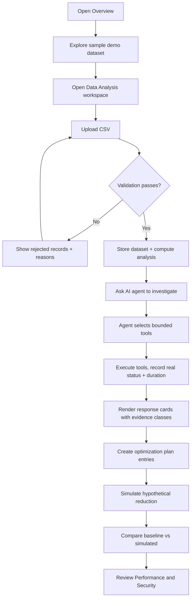

# EcoPilot AI — Product Requirements Document

> Autonomous Sustainability Intelligence Platform — *Think Green. Act Intelligent.*

## 1. Product Overview

EcoPilot AI is an AI-enabled sustainability intelligence platform that helps students, households, offices, and small organizations understand electricity and water consumption, detect unusual patterns, and act on evidence-based recommendations. It pairs a deterministic analytics and calculation engine with a bounded AI agent that can only invoke vetted analytical tools — never arbitrary code.

The product's central principle: **do not merely generate advice — analyze real data, execute verifiable tools, explain findings, and help users make measurable improvements.**

**Target value:** a competition-grade demonstration of secure, intelligent, autonomous application engineering with meaningful AI reasoning, real data processing, and measurable performance.

### 1.1 Evidence Integrity Rules (cross-cutting)

Every value surfaced in the UI carries an explicit **evidence class**:

| Evidence class | Meaning | UI treatment |
|---|---|---|
| `measured` | Parsed directly from an accepted dataset record | Neutral text, source noted |
| `calculated` | Derived by a deterministic formula from measured values | Formula shown in tooltip/help |
| `assumption` | Uses a user-configured or illustrative factor (rate, emissions factor) | "Illustrative assumption" badge |
| `interpretation` | Produced by AI reasoning over evidence | Distinct card styling, labelled AI |
| `simulated` | Result of a hypothetical scenario, not real-world state | Amber "Hypothetical" badge |
| `demo` | Generated sample dataset used for exploration | Persistent `DEMO DATA` badge |

Rules: never present invented data as real measurement; never fabricate percentage changes, historical comparisons, tool durations, or AI execution logs; anomalies are *signals requiring investigation*, not proof of waste or equipment failure.

## 2. Core Features

### 2.1 User Roles

| Role | Registration Method | Core Permissions |
|---|---|---|
| Demo User | None (clearly labelled demo-user indicator) | Full read/write on local workspace: import, analyze, simulate, plan |
| Configured Operator | Backend session (future, via Antigravity secure backend) | Same, plus connected Gemini reasoning and cloud persistence |

No authentication is implemented in the MVP. Identity-dependent controls are explicitly labelled "Demo user" and no fake login form is shown.

### 2.2 Feature Modules

1. **Application shell** — sidebar navigation, top bar with workspace/dataset/agent status, notifications, demo-user menu.
2. **Overview dashboard** — workspace header, dataset + range controls, five metric cards, five charts, evidence-backed insights.
3. **Data Analysis workspace** — CSV drag-and-drop import, schema validation, data preview, accepted/rejected record report, analysis results, anomaly detection, dataset switching.
4. **AI Agent workspace** — conversation history, suggested prompts, agent response cards, execution timeline, bounded tool registry.
5. **Optimization Plans** — recommendation catalogue with priority/status/difficulty, filters, sorting, detail drawer, local persistence.
6. **Impact Simulator** — hypothetical reduction slider + numeric input, baseline vs simulated comparison cards and charts, assumptions panel.
7. **Performance & Security** — real measured performance metrics, recent execution list, security control status board.
8. **Settings** — dataset reset, electricity rate, emissions factor, AI connection status, theme, local data reset, security guidance.

### 2.3 Page Details

| Page | Module | Feature description |
|---|---|---|
| Overview | Workspace header | Heading "Your Sustainability Overview", subtitle, active dataset chip with source and DEMO DATA badge, date-range selector (7/30/90 days/All), refresh analysis action, "Open Data Import" action |
| Overview | Metric cards | Total electricity (kWh), total water (liters), estimated electricity cost (INR), estimated emissions (kg CO2e), potential cost savings (INR). Each shows unit, evidence class, calculation/source explanation, and an unavailable state when inputs are missing |
| Overview | Charts | (A) Electricity over time, (B) Water over time, (C) Estimated electricity expenditure, (D) Baseline vs simulated, (E) Consumption anomalies. Responsive Recharts, tooltips, axis labels, legends, empty states |
| Overview | Insights | Highest-consumption period, average daily electricity, unusual consumption events, areas for further investigation. Each with supporting numbers and an evidence class |
| Data Analysis | Import panel | Drag-and-drop zone, file picker, accepted-format docs, size limit validation, parse progress, cancel/reset, inline error messages |
| Data Analysis | Validation report | Accepted vs rejected record counts, per-row failure reasons, duplicate/missing/negative handling, documented deduplication policy, retry guidance |
| Data Analysis | Preview table | First N parsed rows, column mapping, type inference, per-column validity indicators |
| Data Analysis | Results | Totals, daily/period averages, min/max, estimated cost, estimated emissions, trend direction, anomalies, data-quality warnings |
| Data Analysis | Dataset switcher | Toggle between imported dataset and sample demo dataset without losing the imported one |
| AI Agent | Left rail | Conversation list, "New analysis" button, suggested prompt list, current dataset context card |
| AI Agent | Conversation | Message stream, agent response cards (summary, evidence, measurements, uncertainty, actions, impact, assumptions, verification), follow-up suggestions |
| AI Agent | Tool timeline | Visual stages: request received → objective interpreted → data selected → tool selected → execution → results validated → recommendation generated; each tool step with name, purpose, status, duration, validated output, error |
| AI Agent | States | Loading, missing credentials (fallback mode notice), network failure, timeout, invalid response, empty dataset, unsupported request |
| Optimization Plans | Plan board | Recommendation cards with title, description, evidence, priority, expected impact, estimated savings, difficulty, timeframe, confidence, verification method, status |
| Optimization Plans | Controls | Priority filter, sort (priority/impact/savings), status change (pending/in progress/completed), detail drawer with supporting evidence |
| Impact Simulator | Controls | Slider + numeric input 0–100%, validation messages, immediate recalculation, preset buttons (5/10/15/25%) |
| Impact Simulator | Comparison | Baseline column, simulated column, impact column (electricity saved, cost savings, emissions reduction), grouped bar chart, assumptions panel, "hypothetical" notice |
| Performance & Security | Performance | CSV processing duration, AI request latency, tool execution duration, request counts, tool success/failure counts, validation failures, analysis completion status, recent execution list, rerun test scenario action, "Not measured" states |
| Performance & Security | Security board | Twelve control rows: server-side key protection, input validation, CSV validation, request-size limits, rate limiting, output validation, restricted tools, safe error handling, auth status, persistence config, external connectivity, secrets hygiene. Status ∈ {verified, not-configured, not-verified, unavailable} with concise explanations |
| Settings | Data | Active dataset selector, reset dataset, import preferences (size limit, dedup policy display) |
| Settings | Calculations | Electricity rate (INR/kWh), emissions factor (kg CO2e/kWh), units, reset-to-illustrative-defaults, assumption disclosure |
| Settings | AI | Gemini connection status, current integration mode (Local deterministic / Backend connected), request status, actionable error message when not configured |
| Settings | Preferences | Theme (dark default / light), display preferences, local data reset |
| Settings | Security | Credential configuration guidance, data-handling notice, session and persistence status |

## 3. Core Process

A user opens the platform and lands on the Overview with the sample demo dataset active. They can explore immediately, then import their own CSV in the Data Analysis workspace. Validation produces accepted/rejected records and an analysis summary. From there the user asks the AI agent to investigate; the agent selects bounded analytical tools, the timeline shows real execution states, and response cards separate calculated facts from AI interpretation. The agent's recommendations become optimization plan entries with evidence attached. The user opens the Impact Simulator to test a hypothetical reduction and compares baseline against simulated outcomes. Throughout, the Performance & Security pages report what was actually measured and what is only designed.

## 4. User Interface Design

### 4.1 Design Style

- **Direction:** premium sustainability intelligence console — professional analytics platform fused with an intelligent operations dashboard.
- **Colour:** deep charcoal / near-black base (`#0A0F0D`, `#0F1512`), elevated surfaces `#141B18`; primary accent emerald (`#10B981` / `#34D399`); muted mint for positive indicators (`#6EE7B7`); restrained amber for warnings (`#F59E0B`); red for errors (`#EF4444`); subtle 1px borders (`rgba(255,255,255,0.07)`); controlled glass only on the top bar and modal overlays.
- **Typography:** display + data numerals in **Sora**; body/UI in **Manrope**; tabular numerals for metrics and tables. Five-step scale: 12 / 13 / 14 / 20 / 28–34px.
- **Buttons:** compact, 8px radius, solid emerald primary, ghost/bordered secondary, tactile hover and 1px focus ring; no glow.
- **Layout:** fixed 240px sidebar (collapsible on tablet, drawer on mobile), sticky 56px top bar, 12-column content grid with generous 24–32px gutters.
- **Motion:** 150–220ms ease-out transitions, staggered card entrance on route change, no looping decorative animation.
- **Icons:** Lucide, 16–18px, consistent stroke.
- **Avoid:** generic AI dashboard tropes, heavy gradients, glowing borders, floating ornaments, oversized rounded cards, large empty regions, fake live-activity indicators, fake AI logs, inconsistent spacing.

### 4.2 Page Design Overview

| Page | Module | UI Elements |
|---|---|---|
| Overview | Metric cards | 5-up responsive grid, label (13px uppercase tracking), value (28px Sora tabular), unit, evidence chip, "how is this computed" disclosure, unavailable variant with dashed border |
| Overview | Charts | Card shell with 16px padding, chart title 14px semibold + caption, Recharts area/bar/line, custom dark tooltip, 12px axis ticks, empty-state icon + guidance |
| Overview | Insights | Two-column list of insight rows, left evidence rail colour-coded by class, numeric highlight |
| Data Analysis | Import | 2px dashed drop zone, hover/drag emerald tint, progress bar, error list in red-tinted panel |
| Data Analysis | Preview | Sticky-header table, zebra rows, invalid-cell amber tint, truncation notice |
| AI Agent | Response card | Header with role + timestamp, summary paragraph, evidence list, measurements grid, uncertainty callout (amber), actions list, impact line, assumptions disclosure, verification method |
| AI Agent | Timeline | Vertical rail with connector, node states (pending hollow, running pulsing emerald, succeeded filled, failed red, timed out amber), duration in muted mono |
| Optimization Plans | Board | Filter bar + sort select, 2-column card grid, priority pill, status select, expandable evidence block |
| Impact Simulator | Comparison | Three-column layout (baseline / simulated / impact) with 3 metric rows each, grouped bar chart, amber assumption banner |
| Performance & Security | Security board | Table-like rows with status pill, control name, explanation, category grouping |
| Settings | Sections | Stacked section cards with 2-column label/control rows, destructive actions in red-outline buttons |

### 4.3 Responsiveness

Desktop-first. Sidebar collapses to icon rail at ≤1024px and to an off-canvas drawer at ≤768px. Metric grid: 5 → 3 → 2 → 1 columns. Charts keep a 16:6 aspect and reflow axis tick density. Tables become horizontally scrollable with sticky first column. Simulator slider retains full width with 44px min touch target. All interactive controls ≥ 40px on touch.

### 4.4 3D Scene Guidance

Not applicable — this is a data-dense analytical application; 3D scenes would reduce usability and are intentionally excluded.
