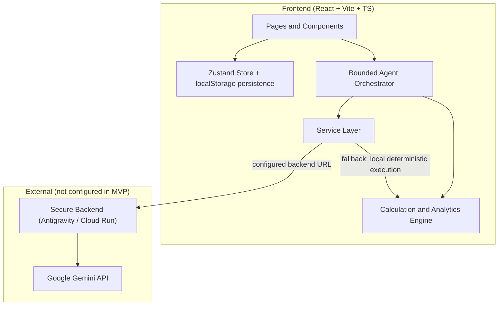
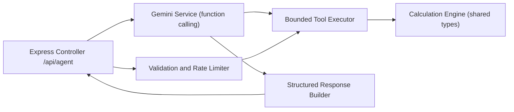
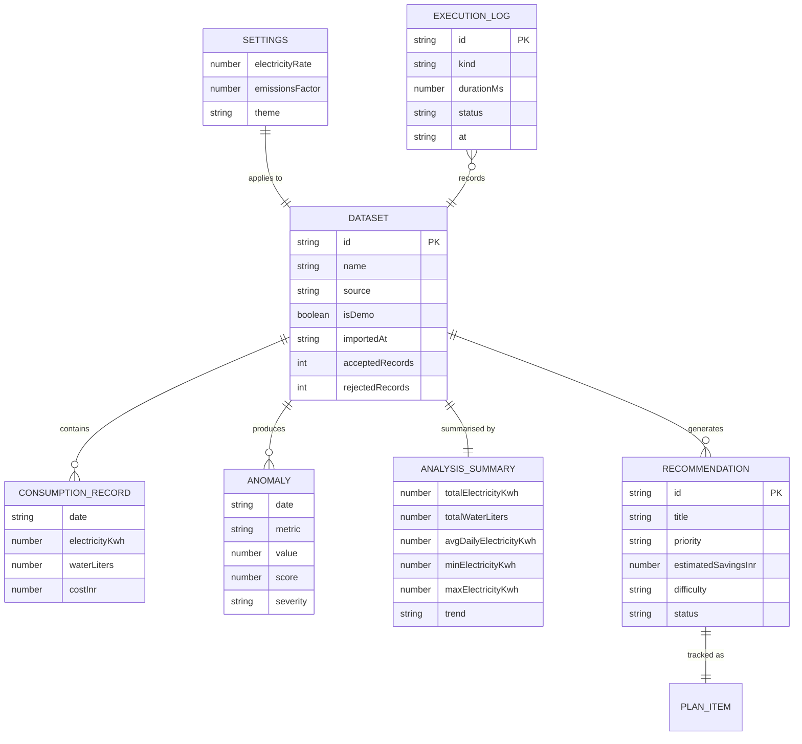

# EcoPilot AI — Technical Architecture

## 1. Architecture Design

Frontend-only MVP with a strict service boundary so a secure backend (built later in Antigravity) can be dropped in without touching UI code.



Key boundary: **the browser never holds an API key.** `src/services/api.ts` resolves an agent endpoint from `VITE_AGENT_API_URL`; when it is absent or unreachable, the orchestrator runs the local deterministic tool pipeline and the UI labels the mode as *Local deterministic fallback*.

## 2. Technology Description

- **Frontend:** React@18 + TypeScript + Vite + Tailwind CSS@3
- **Initialization tool:** `vite-init` with the `react-ts` template
- **Routing:** react-router-dom (static route imports, no lazy loading)
- **State:** zustand with `persist` middleware (localStorage)
- **Charts:** recharts
- **Icons:** lucide-react
- **Backend:** none in the MVP; typed contract prepared for a secure Node/Express backend deployed to Cloud Run / Vercel
- **Database:** none in the MVP; local persistence is isolated behind `src/services/persistence.ts` so it can be replaced by Firestore
- **AI:** Google Gemini via backend function calling. Not configured in this build → deterministic fallback mode is the default and is transparently labelled.

## 3. Route Definitions

| Route | Purpose |
|---|---|
| `/` | Redirects to `/overview` |
| `/overview` | Sustainability overview dashboard |
| `/analysis` | Data import, validation, and analysis workspace |
| `/agent` | AI agent workspace with conversation and tool timeline |
| `/plans` | Optimization plans / action plan board |
| `/simulator` | Impact simulator (what-if scenario modelling) |
| `/performance` | Performance metrics and system evaluation |
| `/security` | Security and reliability control board |
| `/settings` | Data, calculation, AI, preference, and security settings |
| `*` | Not-found page with navigation back to overview |

## 4. API Definitions

Typed contract consumed by `src/services/api.ts`. The local orchestrator implements the same shapes.

```ts
export type EvidenceClass =
  | 'measured' | 'calculated' | 'assumption'
  | 'interpretation' | 'simulated' | 'demo';

export type ToolName =
  | 'get_consumption_summary'
  | 'detect_consumption_anomalies'
  | 'estimate_electricity_cost'
  | 'estimate_emissions'
  | 'simulate_reduction'
  | 'create_optimization_plan';

export type ToolStatus =
  | 'pending' | 'running' | 'succeeded' | 'failed' | 'timed_out';

export interface ToolInvocation {
  id: string;                 // unique execution id
  tool: ToolName;
  purpose: string;
  arguments: Record<string, unknown>;
  status: ToolStatus;
  startedAt: string;          // ISO
  finishedAt?: string;        // ISO
  durationMs?: number;        // real, measured only
  output?: unknown;
  error?: string;
}

export interface AgentRequest {
  requestId: string;
  message: string;
  datasetId: string | null;
  context: {
    recordCount: number;
    dateRange: { from: string | null; to: string | null };
    electricityRate: number;
    emissionsFactor: number;
  };
  history: Array<{ role: 'user' | 'agent'; content: string }>;
}

export interface AgentResponse {
  requestId: string;
  mode: 'backend' | 'fallback';
  status: 'ok' | 'unsupported' | 'error' | 'timeout';
  summary: string;
  evidence: Array<{ label: string; value: string; evidenceClass: EvidenceClass }>;
  measurements: Array<{ label: string; value: number; unit: string }>;
  uncertainty?: string;
  actions: string[];
  estimatedImpact?: { costSavingsInr?: number; emissionsReductionKg?: number };
  assumptions: string[];
  verification: string;
  invocations: ToolInvocation[];
  followUps: string[];
  error?: string;
}

export interface AgentApi {
  health(): Promise<{ connected: boolean; mode: 'backend' | 'fallback'; detail: string }>;
  run(req: AgentRequest, onEvent: (e: AgentEvent) => void): Promise<AgentResponse>;
}

export type AgentEvent =
  | { type: 'stage'; stage: AgentStage; at: string }
  | { type: 'tool'; invocation: ToolInvocation };
```

### 4.1 Tool Registry (bounded)

```ts
interface ToolSpec<A, R> {
  name: ToolName;
  purpose: string;
  validate(args: unknown): A | { error: string };
  execute(args: A, ctx: EngineContext): R;
}
```

| Tool | Purpose | Arguments | Output |
|---|---|---|---|
| `get_consumption_summary` | Totals, averages, min/max, trend | `{ datasetId }` | summary object |
| `detect_consumption_anomalies` | Median-absolute-deviation outlier scan | `{ datasetId, k? }` | anomaly list + method note |
| `estimate_electricity_cost` | kWh × configured rate | `{ datasetId, rateInrPerKwh? }` | cost object |
| `estimate_emissions` | kWh × configured emissions factor | `{ datasetId, factor? }` | emissions object |
| `simulate_reduction` | Hypothetical % reduction | `{ datasetId, reductionPercent }` | baseline/simulated/impact |
| `create_optimization_plan` | Ordered recommendations from findings | `{ datasetId }` | recommendation list |

The agent cannot call anything outside this registry: no shell, no arbitrary code, no unrestricted network access. Unknown requests return `status: 'unsupported'`.

## 5. Server Architecture Diagram

Intended backend (documented; not implemented in the MVP) — Controller → Service → Tool Executor → External.



## 6. Data Model

### 6.1 Data Model Definition



### 6.2 Persistence (local, replaceable)

No SQL database in the MVP. Keys written through `src/services/persistence.ts`:

| Key | Payload |
|---|---|
| `ecopilot.datasets` | Imported datasets + derived analysis |
| `ecopilot.settings` | Electricity rate, emissions factor, theme, preferences |
| `ecopilot.plans` | Plan item status overrides |
| `ecopilot.executions` | Execution log entries (real measurements only) |
| `ecopilot.conversations` | Agent conversation history |

Equivalent Firestore collections when the backend is added: `users/{uid}/datasets`, `users/{uid}/settings`, `users/{uid}/plans`, `users/{uid}/executions`.

## 7. Calculation Engine (authoritative formulas)

| Quantity | Formula | Evidence class |
|---|---|---|
| Electricity cost | `electricity_kwh × rate_inr_per_kwh` | calculated (rate is `assumption`) |
| Emissions | `electricity_kwh × emissions_factor_kg_co2e_per_kwh` | calculated (factor is `assumption`) |
| Simulated consumption | `baseline × (1 − reduction/100)` | simulated |
| Cost savings | `baseline_cost − simulated_cost` | simulated |
| Emissions reduction | `baseline_emissions − simulated_emissions` | simulated |
| Anomaly score | robust z-score using median absolute deviation, `k = 3.5` | calculated |

Defaults are labelled **illustrative assumptions**: `rate = 8.0 INR/kWh`, `emissions_factor = 0.82 kg CO2e/kWh`. Water emissions are never computed (no documented factor configured).

## 8. Security Architecture (as implemented / designed)

- No secret keys in frontend code, bundles, localStorage, or responses. `VITE_AGENT_API_URL` is a non-secret endpoint only.
- API keys live exclusively in backend environment variables; `Settings → AI` states configuration guidance without providing a key input field in the browser.
- CSV import is bounded: file-size limit (5 MB), record-count limit (50 000 rows), strict schema, numeric/date validation, negative-value rejection, explicit duplicate policy, no silent zero-filling.
- Tool execution is restricted to the six-item registry with typed argument validation.
- Error handling is safe: user-facing messages carry no stack traces or credential hints.
- Security page statuses reflect implementation reality: controls present and exercised in the MVP are `verified`; backend-only controls are `not-configured`, with the reason stated.
